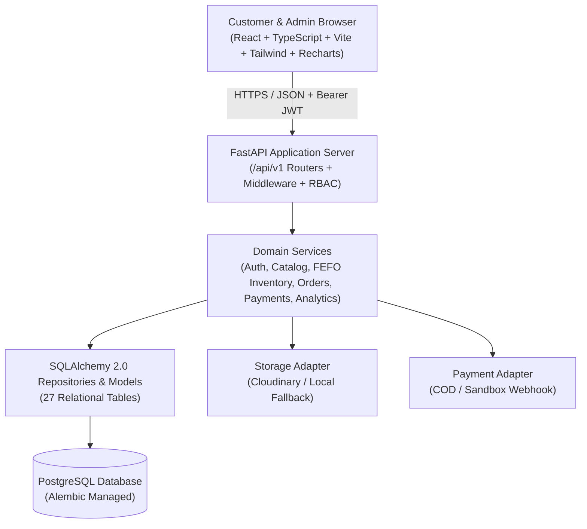

# System Architecture — GlowCart

## 1. System Overview

GlowCart is an international cosmetic e-commerce platform, batch-aware inventory management system, and sales analytics suite built as a modular three-tier web application.

## 2. Three-Tier Architecture

1. **Presentation Tier (`frontend/`):** React 18 + TypeScript + Vite SPA styled with Tailwind CSS semantic beauty tokens (Warm White, Soft Blush Pink, Beige, Neutral Gray, Charcoal), managing client state with Zustand and server state with TanStack Query.
2. **Application Tier (`backend/`):** Python FastAPI modular monolith exposing versioned REST endpoints under `/api/v1`, structured into strict unidirectional layers:
   - `api/v1/` (HTTP routers, dependency injection, RBAC guards)
   - `schemas/` (Pydantic v2 request/response contracts)
   - `services/` (pure domain & transactional workflows: auth, catalog, FEFO inventory, checkout, payments, analytics)
   - `repositories/` (SQLAlchemy 2.0 data-access queries, eager loading to prevent N+1)
   - `models/` (27 SQLAlchemy 2.0 relational entities)
   - `core/` (config, JWT, Argon2id/bcrypt hashing, rate limiter, error handlers, security headers)
3. **Data Tier (`PostgreSQL` + `Alembic`):** Normalized 27-table relational schema enforcing foreign keys, check constraints, unique constraints, numeric precision (`NUMERIC(12,2)`), and Alembic versioned migrations.

## 3. Frontend Architecture

- **Routing & Layouts:** `CustomerLayout` (header search, category nav, cart/wishlist badges, footer) and `AdminLayout` (collapsible sidebar, role-protected `AdminRoute` / `SuperAdminRoute`).
- **State Management:**
  - `authStore` (Zustand): user profile, role, access/refresh tokens, hydration.
  - `cartStore` (Zustand + API sync): optimistic cart count synced with `/api/v1/cart`.
  - TanStack Query: caching, pagination, invalidation for catalog, orders, and analytics.
- **Forms & Validation:** React Hook Form + Zod schemas aligned with backend Pydantic contracts.
- **Analytics Visualization:** Recharts responsive charts (`AreaChart`, `BarChart`, `PieChart`) consuming `/api/v1/admin/analytics/*`.

## 4. Backend Architecture

- **Dependency Direction:** `api/v1` → `services` → `repositories` → `models`. Services never import FastAPI `Request`/`Response` objects directly; transport concerns remain in `api/v1` and `middleware`.
- **Consistent Error Format:** Custom exception handlers return structured JSON `{ "detail": ..., "code": ..., "errors": ... }` with proper HTTP status codes (`400`, `401`, `403`, `404`, `409`, `422`, `429`, `500`) and zero stack-trace leakage.
- **Concurrency & Transaction Safety:** Checkout and stock adjustments execute inside a single database transaction with row locking (`with_for_update()` on PostgreSQL, atomic transaction isolation on SQLite), preventing overselling and negative stock.

## 5. Database Architecture

- 27 relational tables using portable SQLAlchemy `Uuid` primary keys (native `UUID` on PostgreSQL), `NUMERIC(12, 2)` for currency, `DateTime(timezone=True)` timestamps, and check constraints (`available_quantity >= 0`, `reserved_quantity >= 0`, `remaining_quantity >= 0`, `rating BETWEEN 1 AND 5`).
- Snapshot isolation on `orders` (shipping address snapshot JSON + fields) and `order_items` (`product_name_snapshot`, `variant_sku_snapshot`, `variant_label_snapshot`, `unit_price`).

## 6. Authentication & Security Architecture

- **Password Hashing:** Argon2id (`argon2-cffi`) primary, with documented bcrypt fallback if the native Argon2 extension is absent in a constrained local runtime.
- **JWT Lifecycle:** Short-lived Access JWT (`type="access"`, `sub`, `role`, `exp`, `jti`) + Refresh JWT (`type="refresh"`, server-side revocation/blocklist tracking or rotation via `audit_logs`/token store) + password reset token flow.
- **Server-Side RBAC:** FastAPI dependencies `get_current_user`, `require_roles("admin", "super_admin")`, and `require_roles("super_admin")` protect every administrative endpoint.
- **Hardening:** Sliding-window in-memory rate limiter on `/auth/*` and `/payments/*`, strict CORS origins from env, upload MIME/extension/size validation, and immutable `audit_logs`.

## 7. Payment Integration Architecture

- **Adapter Pattern:** `PaymentGateway` interface with:
  1. `CashOnDeliveryAdapter`: creates `PENDING` payment record; collected on delivery (`PAID` upon admin/delivery settlement).
  2. `SandboxPaymentAdapter`: creates payment intent + signed webhook verification (`HMAC-SHA256`) and idempotency-key deduplication (`idempotency_key` unique constraint on `orders` and `provider_event_id` unique constraint on `payment_transactions`).
- **Rule:** Never stores raw card PAN or CVV; never trusts client-supplied success flags.

## 8. Image Storage Architecture

- `StorageService` interface supporting Cloudinary signed/REST upload when `CLOUDINARY_CLOUD_NAME`, `CLOUDINARY_API_KEY`, and `CLOUDINARY_API_SECRET` are configured, with automatic fallback to local `/uploads/products/` static serving in development.

## 9. Deployment Architecture

- **Frontend:** Vercel (`frontend/vercel.json`, `VITE_API_BASE_URL` pointing to Railway backend).
- **Backend & DB:** Railway (`backend/Dockerfile` / `Procfile`, Railway managed PostgreSQL, automated `alembic upgrade head` release command, `/health` readiness check).
- **Local Orchestration:** Root `docker-compose.yml` running `db` (PostgreSQL 16), `backend` (FastAPI + Uvicorn), and `frontend` (Vite dev/Nginx).

## 10. Major Design Decisions and Trade-Offs

1. **Modular Monolith vs. Microservices:** Chosen modular monolith in FastAPI for single-transaction ACID integrity across orders, FEFO batches, and payments without distributed 2PC complexity.
2. **Portable SQLAlchemy `Uuid` & Variant Types:** Enables production PostgreSQL fidelity while allowing fast, deterministic local pytest execution when PostgreSQL daemon is offline.
3. **Separate `inventory` + `inventory_batches` + `inventory_movements`:** Prevents data anomalies, supports cosmetic expiry blocking and FEFO allocation, and guarantees an auditable stock ledger.

